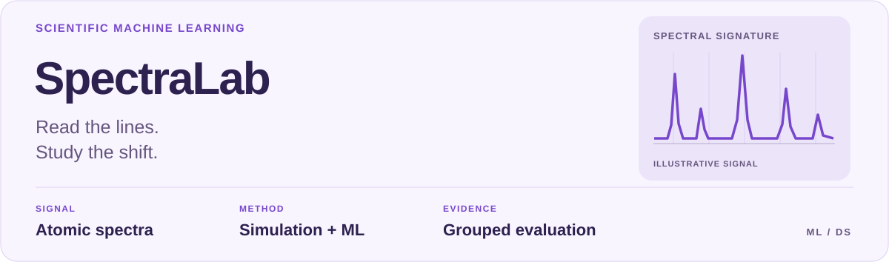
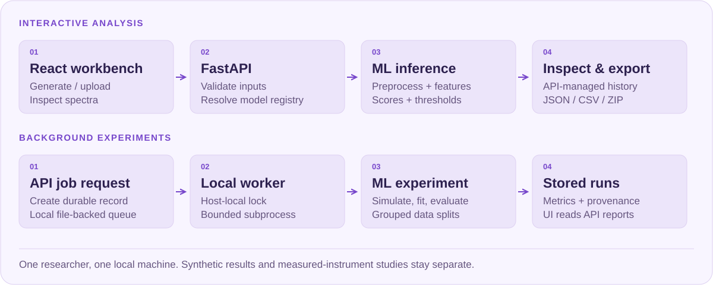

<picture>
  <source media="(max-width: 600px) and (prefers-color-scheme: dark)" srcset="docs/assets/readme/cover-dark-mobile.svg">
  <source media="(max-width: 600px)" srcset="docs/assets/readme/cover-light-mobile.svg">
  <source media="(prefers-color-scheme: dark)" srcset="docs/assets/readme/cover-dark.svg">
  
</picture>

<p align="center">
  <a href="#architecture">Architecture</a> &nbsp;·&nbsp;
  <a href="#research-highlights">Research</a> &nbsp;·&nbsp;
  <a href="#quick-start">Quick start</a> &nbsp;·&nbsp;
  <a href="#documentation">Documentation</a> &nbsp;·&nbsp;
  <a href="docs/usage-guide.md">Подробное руководство</a>
</p>

## Overview

**A reproducible research toolkit for spectral classification, instrument shift
and synthetic-to-real evaluation.**

SpectraLab studies multi-label element identification from LIBS/atomic emission
spectra. It combines physical simulation, classical baselines, learned line
features and grouped evaluation. The standard element set is H, He, Na, Mg, Ca
and Fe. Predictions describe presence; generator weights are not concentrations.

## Architecture

<picture>
  <source media="(max-width: 600px) and (prefers-color-scheme: dark)" srcset="docs/assets/readme/architecture-dark-mobile.svg">
  <source media="(max-width: 600px)" srcset="docs/assets/readme/architecture-light-mobile.svg">
  <source media="(prefers-color-scheme: dark)" srcset="docs/assets/readme/architecture-dark.svg">
  
</picture>

The application supports one researcher on one local machine. FastAPI validates
inputs and manages registries and local storage; the ML package implements the
scientific pipeline. Long-running experiments use a separate worker and durable
file-backed job records.

| Layer | Implementation |
| --- | --- |
| React workbench: analysis, generation, experiments and measurements | [`frontend/src/pages/`](frontend/src/pages/) |
| FastAPI routes, model registry and local storage | [`backend/app/main.py`](backend/app/main.py) · [`services/container.py`](backend/app/services/container.py) |
| Durable jobs and bounded experiment subprocesses | [`backend/app/worker.py`](backend/app/worker.py) |
| Reference data, simulation, preprocessing, estimators and evaluation | [`ml/src/spectralab_ml/`](ml/src/spectralab_ml/) |

<a id="what-this-project-demonstrates"></a>

## Research highlights

| Research question | Evidence | Scope |
| --- | --- | --- |
| Do line-based features tolerate wavelength drift? | Synthetic shift 0.75 nm: line-logistic micro-F1 0.994 vs logistic-ovr 0.493, five matched seeds | Controlled synthetic experiment; no claim of instrument transfer |
| Can a calcium model reduce false positives? | Ca development FPR 7.84% -> 1.96%, recall 90.32% -> 91.40% on the main grouped split | Adaptive development on disclosed data; no independent final |
| Do synthetic models transfer to measurements? | ChemCam external protocol covers 64 physical standards / 255 spectra and exposes large transfer failures | Positive-only labels limit which metrics are identifiable; later replay results are separate |

Sources: [line-feature study](docs/line_classifier_v1.md),
[Ca development protocol](docs/calcium_v4.md),
[historical external validation](docs/external_validation.md).
The archived external figures describe their original implementation; the
[plasma study](docs/plasma_generator_v3.md) documents later changes and replay.

## Evaluation discipline

Physical samples, sessions and repeated shots are grouped where applicable.
Model fitting, calibration and threshold selection use their designated splits.
Synthetic, development, replay and independent final results are labeled
separately. Independent final validation for Fe/Mg remains blocked by missing
admitted external controls. Current metrics do not establish deployment reliability.

## Quick start

The pinned environment is **Python 3.12 · Node 22.14.0 · npm 10.9.2**.
The first setup needs `python3`, `curl`, `tar` and network access.

```bash
git clone https://github.com/ssivitskii/SpectraLab.git
cd SpectraLab
make setup
make demo
make dev
```

`make setup` installs the pinned dependencies and, when needed, a project-local
Node/npm runtime on macOS/Linux. `make demo` creates a small synthetic fixture
dataset, trains local baseline models and runs an API-to-ML smoke check.
The demo fixture is not a NIST dataset.

`make dev` starts the **UI, API and worker** together:
[workbench](http://localhost:5173) · [API documentation](http://localhost:8000/docs).
Stop all three with Ctrl+C. Alternative ports: `API_PORT=8100 UI_PORT=5200 make dev`.

The Photon interface includes spectrum generation and analysis, batch jobs,
measured-profile inference, experiment reports and system status.
[Interface design](docs/photon.md) · [Detailed local setup](docs/local_runtime.md)

<details>
<summary><strong>Docker and individual services</strong></summary>

`docker compose up --build` serves the UI at `localhost:8080` and the API at
`localhost:8000`, bound to loopback. Stop `make dev` first. Compose starts the API
and UI; run the worker separately. `docker compose down` preserves local data.

Individual services: `make api` and `make worker`.
[Full runtime instructions](docs/usage-guide.md#быстрый-запуск)

</details>

## Explore the research

| Start with | What you can inspect |
| --- | --- |
| [Line-feature classifier](docs/line_classifier_v1.md) | Matched-seed synthetic drift study and feature design |
| [Weak-component study](docs/line_classifier_trace_v2.md) | Robust line features, recall gains and drift regressions |
| [Instrument adaptation](docs/instrument_adaptation.md) | Grouped ChemCam study, operational labels and transfer failures |
| [Calcium development](docs/calcium_v4.md) | Disclosed adaptive rounds and limits of the current profile |
| [Plasma generator](docs/plasma_generator_v3.md) | Extended simulation assumptions and historical-test replays |
| [Shot-series analysis](docs/shot_series.md) | Quality control, aggregation and a runnable synthetic example |

```bash
# Install the line-feature model in the local workbench
make line-model

# Run a configured grouped experiment
make experiment CONFIG=ml/configs/experiments/noise_robustness.yaml

# Run the project's software checks
make test
make lint
make build
```

Research commands, source preparation and measured-prediction CLI examples:
[full guide](docs/usage-guide.md#команды-исследований-и-проверки).

## Documentation

| Topic | Guide |
| --- | --- |
| Local setup and troubleshooting | [Runtime](docs/local_runtime.md) · [Full usage guide](docs/usage-guide.md) |
| Data sources and input contracts | [Sources](docs/sources.md) · [CSV and reference data](docs/usage-guide.md#справочники-и-входной-csv) |
| API, storage and exports | [API reference](docs/api.md) · [Artifacts and local operation](docs/usage-guide.md#артефакты-хранение-и-локальный-режим) |
| Scientific assumptions and evaluation | [Physics](docs/physics_assumptions.md) · [Experiment protocol](docs/experiment_protocol.md) · [Results](docs/research_results.md) |
| Current state and next steps | [Roadmap](docs/roadmap.md) · [Verification](docs/verification.md) · [Research history](docs/research-overview-history.md) |

Predictions describe element presence, not concentration. Generator weights are
not mass fractions; a score is not automatically a calibrated probability.
Synthetic accuracy, development results and historical replays do not establish
reliability on an independent instrument. Detailed limitations remain alongside
each linked experiment and in the [usage guide](docs/usage-guide.md).

<details>
<summary>Previous README sections / Разделы подробного руководства</summary>

<a id="быстрый-запуск"></a>

[Быстрый запуск](docs/usage-guide.md#быстрый-запуск)

<a id="что-доступно-в-интерфейсе"></a>

[Что доступно в интерфейсе](docs/usage-guide.md#что-доступно-в-интерфейсе)

<a id="команды-исследований-и-проверки"></a>

[Команды исследований и проверки](docs/usage-guide.md#команды-исследований-и-проверки)

<a id="исследовательский-профиль-прибора"></a>

[Исследовательский профиль прибора](docs/usage-guide.md#исследовательский-профиль-прибора)

<a id="справочники-и-входной-csv"></a>

[Справочники и входной CSV](docs/usage-guide.md#справочники-и-входной-csv)

<a id="физика-модели-и-область-применимости"></a>

[Физика, модели и область применимости](docs/usage-guide.md#физика-модели-и-область-применимости)

<a id="артефакты-хранение-и-локальный-режим"></a>

[Артефакты, хранение и локальный режим](docs/usage-guide.md#артефакты-хранение-и-локальный-режим)

<a id="генерация-из-cli-и-расширение"></a>

[Генерация из CLI и расширение](docs/usage-guide.md#генерация-из-cli-и-расширение)

<a id="проверка-и-дальнейшая-работа"></a>

[Проверка и дальнейшая работа](docs/usage-guide.md#проверка-и-дальнейшая-работа)

</details>

---

[← Back to portfolio](https://github.com/ssivitskii#selected-work)
