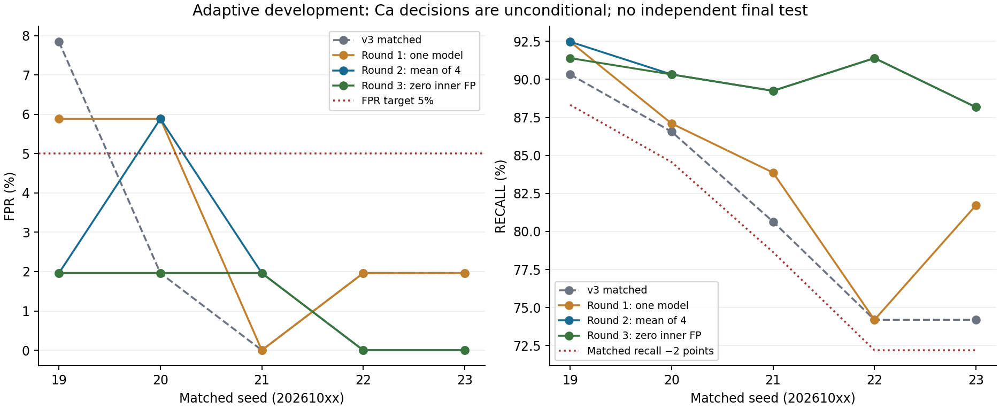

# Calcium specificity: adaptive development

All three rounds use only the already disclosed 202 spectra / 199 physical materials. Ca support is 93 positive and 51 negative physical weights. These are adaptive development results, not an independent final test. Ca decisions are unconditional; refusal cannot remove false negatives from recall.

| Seed | v3 TP / FP | Round 1 TP / FP | Round 2 TP / FP | Round 3 TP / FP |
|---|---:|---:|---:|---:|
| 20261019 | 84 / 4 | 86 / 3 | 86 / 1 | 85 / 1 |
| 20261020 | 80.5 / 1 | 81 / 3 | 84 / 3 | 84 / 1 |
| 20261021 | 75 / 0 | 78 / 0 | 83 / 1 | 83 / 1 |
| 20261022 | 69 / 1 | 69 / 1 | 85 / 0 | 85 / 0 |
| 20261023 | 69 / 1 | 76 / 1 | 82 / 0 | 82 / 0 |

True-positive counts can be fractional because replicates of one physical material share weight one. All negatives here are unique. The primary target is at least 83/93 positives and at most 2/51 negatives detected. The original strict five-seed criterion requires this absolute target on all seeds. A separately declared secondary criterion preserves each seed's own v3 recall within 2 percentage points, requires FPR ≤5% on each seed, and retains ≥83 TP on the primary seed.

Round 1: primary recall 92.47%, FPR 5.88%; strict five-seed target **False**, matched secondary target **False**. Primary paired 95% conditional interval for recall change [0.00, 7.77] percentage points, FPR change [-13.34, 10.21] percentage points.
Absolute primary FPR interval [0.00%, 16.67%]. Across five matched seeds, mean ± sample SD: recall 83.87% ± 6.76 pp; FPR 3.14% ± 2.63 pp.

Round 2: primary recall 92.47%, FPR 1.96%; strict five-seed target **False**, matched secondary target **False**. Primary paired 95% conditional interval for recall change [0.00, 7.77] percentage points, FPR change [-15.15, 0.00] percentage points.
Absolute primary FPR interval [0.00%, 6.38%]. Across five matched seeds, mean ± sample SD: recall 90.32% ± 1.70 pp; FPR 1.96% ± 2.40 pp.

Round 3: primary recall 91.40%, FPR 1.96%; strict five-seed target **False**, matched secondary target **True**. Primary paired 95% conditional interval for recall change [0.00, 3.88] percentage points, FPR change [-15.15, 0.00] percentage points.
Absolute primary FPR interval [0.00%, 6.38%]. Across five matched seeds, mean ± sample SD: recall 90.11% ± 1.40 pp; FPR 1.18% ± 1.07 pp.



Round 1 preregistered 45 combinations of three reference-defined feature families and logistic/RBF regularization grids. Its existing fit/calibrate/tune and outer partitions exactly match v3. Calcium blue-line agreement uses Ca I/II lines 393.477, 396.959, 422.792 and 445.603 nm with local continuum/noise features. The global primary selector maximizes inner recall under FPR budget .025, then specificity, Brier and complexity. Budget .05 and family selectors are fully reported as alternatives; no best outer result selects the artifact.

Round 2 was explicitly designed after round 1 outcomes. It keeps the same 45 candidates and five outer partitions, and uses four inner group folds. Each inner-heldout probability averages four independently fit/calibrated models excluding the heldout groups. Outer prediction also averages four members. Calibration takes 25% of available groups with support checks. Inner members still train on fewer groups than outer members; averaging alignment does not remove training-size effects or guarantee population FPR.

Round 3 was declared after round 2 still produced three false positives on seed 20261020. It changes only the inner empirical FPR budget to zero and reruns the same candidate/threshold rule on pinned saved inner OOF probabilities. No models or calibrators are retrained; no outer labels enter selection. All previous attempts remain disclosed. This last planned round meets the matched five-seed point criterion, while the original stricter absolute-recall criterion fails on seed23. The search stops here. These adaptive outcomes cannot guarantee FPR ≤5% on new data.

Grouping is transitive over physical material, family, acquisition session and input checksum. Unknown, missing, zero and intermediate assays never become negative labels. Calibration and threshold fitting use only known internal labels. All candidate scores, partitions, calibration states and outer metrics are retained. The JSON summary includes all fixed candidate attempts and selector summaries.

The original round 1 lock omitted explicit OOF/profile byte pins. An immutable amended protocol adds them, verifies ordered IDs, groups, labels and feature plans against the original v3 source, and checks the profile hash in the original completed result. Its full repeated experiment produced exactly the same per-seed result objects. The original run remains available with that disclosed integrity limitation. Known prior development OOF/profiles (and round2 cached features) are read before the new candidate-scoring lock. Locked-before-scoring does not mean all numerical inputs were unread: no new final intensities or final predictions were consumed.

Paired intervals resample connected clusters from fixed predictions (2000 draws), without retraining. They are conditional, not independent campaign uncertainty. Five seeds reuse the same samples. No error-free bootstrap can establish a zero population error rate. All numeric research artifacts preserve original v3 Na/Mg/Fe and use unconditional Ca. None is automatically promoted. The four-member mean combines Platt-calibrated scores; it has no independent final recalibration.

Reproduction requires the pinned historical v3 runs, source development raw files and the preceding round2 cache. Reports/raw inputs are ignored local artifacts, so a fresh checkout alone does not contain all research inputs. Do not silently replace pinned inputs with newly generated runs. BLAS threads must remain 1:

```sh
export OPENBLAS_NUM_THREADS=1 OMP_NUM_THREADS=1
export MKL_NUM_THREADS=1 VECLIB_MAXIMUM_THREADS=1
scripts/uv.sh run --frozen --all-packages --no-sync python scripts/study_calcium_v4.py
scripts/uv.sh run --frozen --all-packages --no-sync python scripts/study_calcium_crossfit_v4.py
scripts/uv.sh run --frozen --all-packages --no-sync python scripts/study_calcium_operating_v4.py
```

Pinned declarations: `data/reference/calcium_v4_round1_protocol.json`, `data/reference/calcium_v4_round1_verified_protocol.json`, `data/reference/calcium_v4_round2_protocol.json`, `data/reference/calcium_v4_round3_protocol.json`. Numeric results: `docs/calcium_v4_summary.json`.
