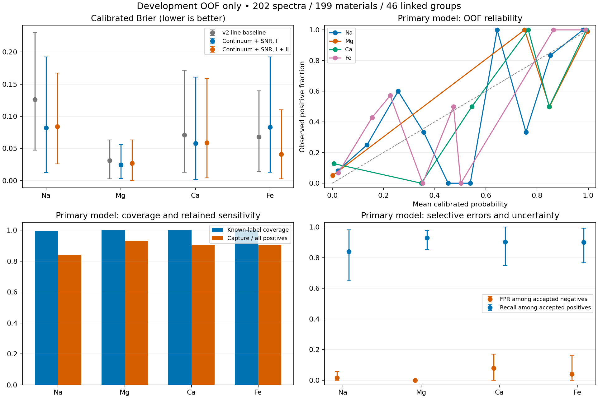

# Development-only line evidence, calibration and selective refusal

This protocol compares three fixed variants on the already disclosed ChemCam
development pool: 202 measurements, 199 physical materials. The former v1 test
set is development data. This is not independent final or blank validation.

Before reading spectra, the runner writes a pinned protocol with data checksums,
feature plans, implementation hashes, dependency versions and every partition.
The metadata-only source is `data/reference/development_v4_source_plan.json`, a
byte-identical copy of the prior v2 development plan. The fixed seed is 20261019.

The comparisons are the unchanged v2 line features, local linear continuum plus
robust sideband SNR using neutral lines, and the same corrected features using
neutral and singly ionized lines with stage summaries. Line centers are selected
only from the pinned reference. Local band normalization and stage contrast are
proxies; no measured instrument-response correction or plasma-temperature
estimation is claimed. The ion variant is the deployment candidate fixed before
outer predictions, irrespective of its eventual ranking.

Five campaign-stratified outer folds preserve the transitive closure of physical
sample, family, session and input checksum. Inside each outer training pool,
three disjoint group sets fit the balanced logistic model, calibrate monotonic
Platt probabilities with equal physical weights, and tune C, decision thresholds
and refusal. The first seeded metadata partition with at least two positive and
negative groups per element in each role is used; no spectral outcome enters this
search. Model C is one of 0.01, 0.1, 1.0. Tuning maximizes macro balanced accuracy
under a per-element empirical FPR budget of 0.05. This is a tuning constraint,
not a guaranteed future error bound.

Refusal considers minimum local SNR in {0, 2, 5, 10} and distance from the decision
threshold in {0, 0.05, 0.1, 0.2}. Tuning maximizes selective balanced accuracy under
known-label coverage >=0.5 and selective empirical FPR <=0.05. The report includes
accepted false negatives, refused positives, conditional sensitivity and positive
capture among all known positives. Unknown composition labels never become
negative training or evaluation labels. H and He remain unknown.

All reported performance uses outer-fold predictions. Brier and ten-bin ECE use
equal total weight per physical material, without class balancing. Intervals are
1,000 paired connected-cluster bootstrap resamples of fixed OOF predictions;
they do not refit models or adjust for multiple comparisons. A separate numeric
deployment profile uses a predeclared fit/calibrate/tune partition of development
data; its fitting scores are retained only for audit, never reported as validation.

Run with `scripts/uv.sh run --frozen --all-packages --no-sync python
scripts/study_development_v3.py`. The initial protocol and subsequent result are
saved below `reports/adaptation_v3/`. Raw spectra remain in their existing ignored
local paths; the runner checks every source checksum.

## Completed locked run

Run `development-20261019T172235-da8f0847` completed in 25.7 seconds.
All 15 outer model/fold fits completed on the same five partitions, followed by
the separately partitioned deployment profile. Protocol SHA256:
`329c395cabab5d934ac7b910590fc73d6f6c4dcd017b0216b2814093a4388f80`.

| Variant | Raw Brier | Calibrated Brier | Cal. ECE | Known coverage | Selective FPR | Selective recall | Capture / all positives |
| --- | --- | --- | --- | --- | --- | --- | --- |
| v2 line baseline | 0.072 | 0.074 | 0.082 | 0.998 | 0.031 | 0.819 | 0.819 |
| Continuum + SNR, I | 0.065 | 0.062 | 0.064 | 0.991 | 0.078 | 0.874 | 0.874 |
| Continuum + SNR, I + II | 0.053 | 0.053 | 0.054 | 0.998 | 0.034 | 0.893 | 0.893 |

These macro values average the four elements. Raw balanced logistic scores are
shown as a diagnostic; they are not claimed to be calibrated probabilities.
The paired intervals below are exploratory development uncertainty, not final
qualification or evidence of performance on certified blanks.

| Paired macro Brier difference (negative is better) | Estimate [95% interval] |
| --- | --- |
| v2 line baseline: calibrated minus raw | 0.002 [-0.007, 0.012] |
| Continuum + SNR, I: calibrated minus raw | -0.003 [-0.013, 0.009] |
| Continuum + SNR, I + II: calibrated minus raw | -0.001 [-0.005, 0.003] |
| continuum-snr-neutral minus calibrated baseline | -0.012 [-0.028, 0.003] |
| continuum-snr-ion minus calibrated baseline | -0.021 [-0.031, -0.011] |

The I + II feature package has lower development Brier than the calibrated baseline
in this primary run. The paired interval for Platt calibration itself crosses zero,
so it does not establish a separate calibration improvement. The refusal policy
is almost inactive: it rejects one known-negative Na material and no known positive
in the primary OOF evaluation. It does not demonstrate improved selective safety.
Ca's OOF FPR exceeds the tuning budget. These results do not qualify the model for
practical use or replace independent external/blank evaluation.



### Primary candidate: support and retained sensitivity

| Element | Positive | Negative | Unknown | Known coverage [CI] | Selective FPR [CI] | Selective recall [CI] | Capture / all positives [CI] |
| --- | --- | --- | --- | --- | --- | --- | --- |
| Na | 75 | 64 | 60 | 0.993 [0.977, 1.000] | 0.016 [0.000, 0.057] | 0.840 [0.648, 0.981] | 0.840 [0.648, 0.981] |
| Mg | 99 | 39 | 61 | 1.000 [1.000, 1.000] | 0.000 [0.000, 0.000] | 0.929 [0.854, 0.979] | 0.929 [0.854, 0.979] |
| Ca | 93 | 51 | 55 | 1.000 [1.000, 1.000] | 0.078 [0.000, 0.170] | 0.903 [0.748, 1.000] | 0.903 [0.748, 1.000] |
| Fe | 141 | 25 | 33 | 1.000 [1.000, 1.000] | 0.040 [0.000, 0.160] | 0.901 [0.767, 0.992] | 0.901 [0.767, 0.992] |

Intervals resample 46 linked groups. Fe has only 25 known negative physical
materials across 12 linked groups. Unknown truth is excluded from FPR/recall;
acceptance on these rows can be counted but its correctness cannot be measured.
Mg has no observed false positives: its bootstrap interval collapses to [0, 0].
This degeneracy does not establish zero population FPR or bound unseen failures;
an independent negative-control evaluation is still required.

| Element | Accepted TP | Accepted FP | Accepted FN | Accepted TN | Refused positive | Refused negative | Unknown-truth acceptance |
| --- | --- | --- | --- | --- | --- | --- | --- |
| Na | 63.000 | 1.000 | 12.000 | 62.000 | 0.000 | 1.000 | 1.000 |
| Mg | 92.000 | 0.000 | 7.000 | 39.000 | 0.000 | 0.000 | 1.000 |
| Ca | 84.000 | 4.000 | 9.000 | 47.000 | 0.000 | 0.000 | 1.000 |
| Fe | 127.000 | 1.000 | 14.000 | 24.000 | 0.000 | 0.000 | 1.000 |

Confusion counts are physical-material weights: repeated measurements total one
per material. Selective recall divides accepted true positives by all accepted
positives, including accepted false negatives. Capture divides by all positives,
including refusals; this prevents refusal from concealing lost sensitivity.

### Calibration detail

| Variant | Element | Raw Brier | Cal. Brier | Raw ECE | Cal. ECE |
| --- | --- | --- | --- | --- | --- |
| v2 line baseline | Na | 0.110 | 0.126 | 0.124 | 0.136 |
| v2 line baseline | Mg | 0.043 | 0.031 | 0.064 | 0.035 |
| v2 line baseline | Ca | 0.066 | 0.071 | 0.076 | 0.077 |
| v2 line baseline | Fe | 0.068 | 0.068 | 0.077 | 0.079 |
| Continuum + SNR, I | Na | 0.093 | 0.082 | 0.104 | 0.097 |
| Continuum + SNR, I | Mg | 0.025 | 0.025 | 0.052 | 0.025 |
| Continuum + SNR, I | Ca | 0.057 | 0.058 | 0.077 | 0.055 |
| Continuum + SNR, I | Fe | 0.086 | 0.083 | 0.095 | 0.077 |
| Continuum + SNR, I + II | Na | 0.084 | 0.084 | 0.095 | 0.080 |
| Continuum + SNR, I + II | Mg | 0.024 | 0.027 | 0.043 | 0.026 |
| Continuum + SNR, I + II | Ca | 0.056 | 0.059 | 0.076 | 0.060 |
| Continuum + SNR, I + II | Fe | 0.049 | 0.041 | 0.058 | 0.049 |

The calibration population consists of the known extreme operational labels,
not all chemical compositions. Zero/missing and strictly 0.1 < x < 1 oxide wt%
remain unknown;
these probabilities are not concentration estimates or calibrated for those
unknown states. ECE uses ten fixed equal-width bins and is sample-size sensitive.

### Campaign slices of the primary candidate

| Campaign | Element | Cal. Brier | Known coverage | Selective FPR | Selective recall | Capture / all positives |
| --- | --- | --- | --- | --- | --- | --- |
| 0 | Na | 0.029 | 1.000 | 0.029 | 0.957 | 0.957 |
| 0 | Mg | 0.001 | 1.000 | 0.000 | 0.963 | 0.963 |
| 0 | Ca | 0.013 | 1.000 | 0.100 | 1.000 | 1.000 |
| 0 | Fe | 0.008 | 1.000 | 0.125 | 1.000 | 1.000 |
| 1 | Na | 0.159 | 0.983 | 0.000 | 0.655 | 0.655 |
| 1 | Mg | 0.090 | 1.000 | 0.000 | 0.789 | 0.789 |
| 1 | Ca | 0.143 | 1.000 | 0.000 | 0.775 | 0.775 |
| 1 | Fe | 0.102 | 1.000 | 0.000 | 0.659 | 0.659 |

Campaign slices are descriptions of held-out group predictions within development,
not an untouched campaign transfer test. Campaign 0 means acquisition sessions
before 2016-01-01; campaign 1 means sessions on or after that date. These are
acquisition-date groups, not archive release directories: some calib_2021 files,
including additional disclosed Mg-low materials, were acquired before 2016.


### Post-primary sensitivity audit

After seeing the primary result, the four additional seeds 20261020–20261023
were fixed in a coordination message before their execution. The audit JSON was
materialized after execution began, before inspecting these additional results;
it is not represented as a pre-primary preregistration. All five seeds completed
with identical data, feature variants and implementation hashes. No model,
threshold rule or deployment candidate was changed or chosen using this audit.

| Variant | Cal. Brier | Cal. ECE | Known coverage | Selective FPR | Selective recall | Capture / all positives |
| --- | --- | --- | --- | --- | --- | --- |
| v2 line baseline | 0.084 ± 0.016 | 0.092 ± 0.022 | 0.998 ± 0.003 | 0.025 ± 0.021 | 0.790 ± 0.052 | 0.789 ± 0.050 |
| Continuum + SNR, I | 0.069 ± 0.005 | 0.070 ± 0.006 | 0.989 ± 0.010 | 0.050 ± 0.018 | 0.829 ± 0.034 | 0.824 ± 0.035 |
| Continuum + SNR, I + II | 0.066 ± 0.012 | 0.065 ± 0.007 | 0.996 ± 0.004 | 0.028 ± 0.008 | 0.848 ± 0.036 | 0.847 ± 0.036 |

Mean ± sample standard deviation (ddof=1) across five matched split seeds
describes partition variability on the same 199 materials. It is not a confidence
interval or five independent datasets. The deployment profile remains the original
seed 20261019 profile. The audit source is `data/reference/development_v3_sensitivity_audit.json`.


### Reproduction and audit

The numeric deployment artifact is `/Users/stepansivitskii/Desktop/SpectraLab/reports/adaptation_v3/development-20261019T172235-da8f0847/profile.json`,
SHA256 `8ffb76657c9618ff5c393b8be99690b2ceb41528d65529ebab31437caaf37c80`. It contains the fixed feature plan,
logistic coefficients/scalers, monotonic calibrators, thresholds, refusal policy,
instrument identity and operational oxide policy. `LineAdapterV3.load` validates
one bounded no-follow JSON buffer, numeric dimensions, fixed semantics and digest.

`protocol.json` contains all source IDs/checksums and every outer/inner assignment.
Each fold saves its numeric profile, candidate fit/calibration/tuning scores and
selection audit; `development_oof.npz` saves per-record probabilities, decisions,
refusals, SNR, truth and cluster IDs. The same records/partitions support all models.
The deployment primary is fixed before outer scoring and is not chosen from this
table. Its in-sample scores are never used as reported validation performance.

Regenerate this report with:

```sh
scripts/uv.sh run --frozen --all-packages --no-sync python scripts/report_development_v3.py \
  --run-dir reports/adaptation_v3/development-20261019T172235-da8f0847 \
  --additional-run reports/adaptation_v3/development-20261019T172516-562e7b55 \
  --additional-run reports/adaptation_v3/development-20261019T172542-10651dbf \
  --additional-run reports/adaptation_v3/development-20261019T172608-dd27d703 \
  --additional-run reports/adaptation_v3/development-20261019T172635-e969bcd7
scripts/uv.sh run --frozen --all-packages --no-sync pytest -q \
  ml/tests/test_line_adapter_v3.py ml/tests/test_development_v3.py
```

The model remains **development-only**. Real response calibration, independent
campaign transfer, certified low-Fe/Fe–Mg blanks and an untouched final assessment
remain separate data and qualification requirements. A tuning FPR budget does
not guarantee that OOF or future FPR satisfies that budget.
