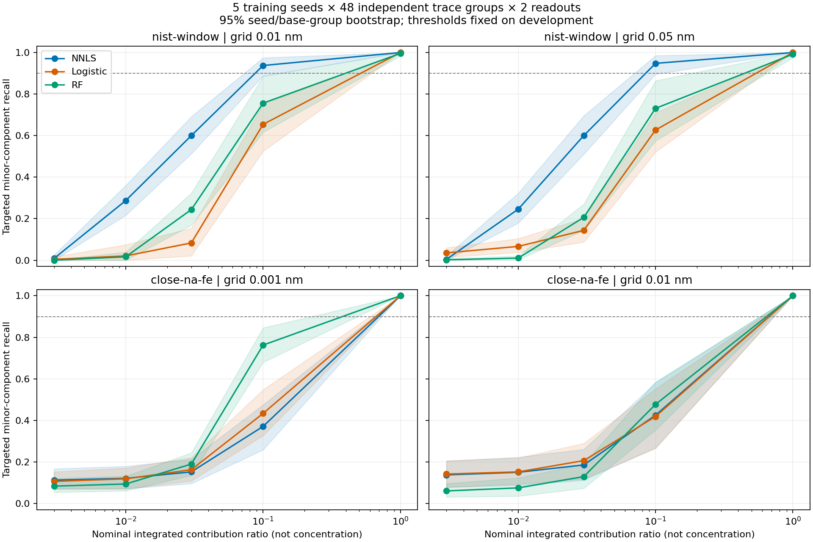

# Расширенный benchmark — 2026-10-13

Выполнены все **20 из 20** комбинаций seed × сценарий × сетка: **60 моделей**,
**126 агрегированных ячеек**, пять полных seed, без failed/incomplete.
Этот эксперимент выявляет слабые примеси и неоднозначность близких линий,
которые не были видны в прежних сериях на 36–48 base samples. Данные синтетические;
реальные измерения рассматриваются отдельно в [ML08](external_validation.md).

## Заранее зафиксированные условия

[Конфиг](../ml/configs/expanded_benchmark.yaml) и локальный `preregistration.json`
зафиксированы **до первого прогноза**, в 2026-10-13T15:17:19.322717+00:00. Это локальная фиксация
протокола, не публичная регистрация исследования. Выполнение закончено в
2026-10-13T15:22:39.239258+00:00. После просмотра test ни сетка, ни пороги, ни модели
не перенастраивались; все запланированные условия приведены ниже.

Источник — сохранённые официальные выгрузки [NIST ASD](https://physics.nist.gov/PhysRefData/ASD/lines_form.html),
нейтральные линии в vacuum nm. Внутри каждого элемента сумма line priors
приведена к единице, поэтому веса означают **относительный интегральный вклад
сигнала**, а не концентрацию. Неуказанный prior принимается равным единице.
Исходные поля NIST и SHA родительского каталога сохранены в производных каталогах.

| Сценарий | Источник линий | Сетка, nm | Training FWHM, nm | Test профили, nm |
| --- | --- | --- | --- | --- |
| nist-window | 247 линий H/He/Na/Mg/Ca/Fe, 390–405 nm | 0.01; 0.05 | 0.05 | Gaussian 0.02, 0.05, 0.20; Voigt G/L 0.05/0.05; response tilt |
| close-na-fe | Na 392.67000 / Fe 392.67551 nm, окно 392.4–392.9 | 0.001; 0.01 | 0.01 | Gaussian 0.002, 0.01, 0.05; Voigt G/L 0.01/0.01 |

В close-na-fe расстояние **0.00551 nm** взято из каталога. Другие переходы
намеренно исключены: это отдельная задача идентифицируемости двух линий,
а не утверждение о полном Na/Fe спектре. Response tilt линейно меняется
от 0.5 до 1.5 по окну; это контролируемая модель, не измеренная характеристика прибора.

Seeds: **7, 17, 29, 43, 71**. На каждый seed/сценарий генерируются **240 независимых
base compositions**: 144 train, 48 validation, 48 test; составы содержат 1–3 элемента
(1–2 для close-na-fe), непрерывные случайные веса 0.1–1.0. К каждой base composition
относятся два шумовых измерения. Отдельно создаются **48 независимых trace compositions**
с выбранными major/minor элементами и отношениями **1, 0.1, 0.03, 0.01, 0.003, 0**.
Нулевое отношение — отрицательный контроль именно выбранного minor элемента.
Всего 2 880 физических base/trace групп в двух задачах; повторение профилей и сеток
не увеличивает это число. В каждой итоговой ячейке **240 групп / 480 измерений**.

Line amplitudes имеют независимую логнормальную вариацию sigma=0.08; shift каждой
base composition непрерывен, sigma=0.003 nm и 0.0005 nm соответственно.
Шум Gaussian, RMS SNR=35 dB. Состав, line perturbations и shift совпадают между
моделями, профилями и сетками; шумовые реализации разных сеток независимы.
Профили интегрируются по пикселям теми же kernels, что основной генератор.
Номинальный trace ratio немного отличается от фактического в конечном окне;
его mean/min/max также сохранены в исходных отчётах.

NNLS использует шаблоны обучающего профиля; Logistic и RF обучаются на том же train.
Все пороги выбираются только по validation base IDs. После этого модель и пороги
сохраняются и неизменно применяются ко всем test профилям и trace ratios.
Для каждой сетки обучается отдельная модель с совпадающими split IDs.
CNN в этот фиксированный протокол не включена.

## Неопределённость и support

В таблицах `estimate [low, high]` — pooled metric и **95% percentile CI**, 1 000
иерархических bootstrap повторов: сначала resampling пяти training seeds,
затем физических групп внутри seed. Два readout одной группы всегда остаются вместе.
Для разностей моделей и сеток используются одинаковые bootstrap draws.
Модели в bootstrap не переобучаются. Отдельно сохранены mean по seeds и SD с `ddof=1`;
это другая оценка, её не следует смешивать с CI для pooled metric.

Интервалы exploratory, без поправки на множество сравнений. Пять training seeds
ограничивают точность покрытия. Bootstrap при наблюдаемом нуле ошибок может давать
[0, 0]: это **не доказательство нулевой истинной ошибки** и не верхняя граница риска.

Число физических групп с положительным элементом в ordinary test и число trace
групп, где именно этот элемент назначен minor (последний столбец в каждом сценарии
суммируется до 240):

| Сценарий | Элемент | Positive test groups | Targeted trace groups |
| --- | --- | --- | --- |
| nist-window | H | 76 | 42 |
| nist-window | He | 69 | 41 |
| nist-window | Na | 78 | 37 |
| nist-window | Mg | 95 | 44 |
| nist-window | Ca | 85 | 46 |
| nist-window | Fe | 75 | 30 |
| close-na-fe | Na | 186 | 110 |
| close-na-fe | Fe | 178 | 130 |

Reference micro-F1, mean ± SD по пяти seeds:

| Сценарий | Шаг nm | NNLS | Logistic | RF |
| --- | --- | --- | --- | --- |
| nist-window | 0.01 | 0.9990 ± 0.0023 | 0.9827 ± 0.0074 | 0.9794 ± 0.0120 |
| nist-window | 0.05 | 1.0000 ± 0.0000 | 0.9722 ± 0.0111 | 0.9708 ± 0.0142 |
| close-na-fe | 0.001 | 0.9695 ± 0.0204 | 0.9806 ± 0.0138 | 0.9856 ± 0.0135 |
| close-na-fe | 0.01 | 0.9669 ± 0.0187 | 0.9690 ± 0.0172 | 0.9844 ± 0.0106 |

## Изменение профиля

Micro-F1 с pooled CI; `reference` — профиль обучения. Новые профили проверяются
без адаптации шаблонов или порогов.

| Сценарий | Шаг nm | Профиль | NNLS | Logistic | RF |
| --- | --- | --- | --- | --- | --- |
| nist-window | 0.01 | reference | 0.999 [0.996, 1.000] | 0.983 [0.972, 0.992] | 0.979 [0.965, 0.990] |
| nist-window | 0.01 | narrow | 0.982 [0.969, 0.992] | 0.956 [0.924, 0.978] | 0.857 [0.810, 0.911] |
| nist-window | 0.01 | broad | 0.853 [0.825, 0.880] | 0.878 [0.854, 0.906] | 0.742 [0.705, 0.779] |
| nist-window | 0.01 | voigt-tails | 0.885 [0.856, 0.916] | 0.929 [0.910, 0.947] | 0.752 [0.723, 0.782] |
| nist-window | 0.01 | response-tilt | 0.998 [0.993, 1.000] | 0.980 [0.968, 0.990] | 0.977 [0.962, 0.990] |
| nist-window | 0.05 | reference | 1.000 [1.000, 1.000] | 0.972 [0.959, 0.984] | 0.971 [0.953, 0.986] |
| nist-window | 0.05 | narrow | 0.998 [0.993, 1.000] | 0.969 [0.958, 0.980] | 0.934 [0.906, 0.964] |
| nist-window | 0.05 | broad | 0.864 [0.837, 0.891] | 0.904 [0.872, 0.932] | 0.755 [0.723, 0.787] |
| nist-window | 0.05 | voigt-tails | 0.886 [0.859, 0.912] | 0.942 [0.905, 0.976] | 0.752 [0.728, 0.778] |
| nist-window | 0.05 | response-tilt | 0.999 [0.995, 1.000] | 0.974 [0.961, 0.985] | 0.974 [0.958, 0.987] |
| close-na-fe | 0.001 | reference | 0.970 [0.949, 0.986] | 0.981 [0.965, 0.993] | 0.986 [0.972, 0.996] |
| close-na-fe | 0.001 | narrow | 0.099 [0.043, 0.159] | 0.148 [0.016, 0.282] | 0.849 [0.810, 0.885] |
| close-na-fe | 0.001 | broad | 0.842 [0.810, 0.872] | 0.863 [0.836, 0.886] | 0.863 [0.836, 0.886] |
| close-na-fe | 0.001 | voigt-tails | 0.874 [0.840, 0.905] | 0.863 [0.835, 0.888] | 0.863 [0.835, 0.888] |
| close-na-fe | 0.01 | reference | 0.967 [0.946, 0.984] | 0.969 [0.950, 0.985] | 0.984 [0.972, 0.994] |
| close-na-fe | 0.01 | narrow | 0.912 [0.885, 0.940] | 0.911 [0.883, 0.940] | 0.881 [0.853, 0.909] |
| close-na-fe | 0.01 | broad | 0.672 [0.589, 0.768] | 0.863 [0.836, 0.886] | 0.863 [0.836, 0.886] |
| close-na-fe | 0.01 | voigt-tails | 0.901 [0.859, 0.932] | 0.885 [0.850, 0.912] | 0.863 [0.835, 0.888] |

Для оценки разрешения близких линий одного F1 недостаточно: при предсказании обоих
классов для каждого спектра он может оставаться высоким. Дополнительные exact-match,
Hamming loss и разделение single/mixture сохранены в исходных per-seed metrics.

## Слабый компонент и отрицательный контроль

Здесь оценивается recall **назначенного minor элемента**, а не общий F1,
который может скрыть пропуски примеси за правильным major элементом.



| Сценарий | Шаг nm | Trace ratio | NNLS | Logistic | RF |
| --- | --- | --- | --- | --- | --- |
| nist-window | 0.01 | 1 | 1.000 [1.000, 1.000] | 1.000 [1.000, 1.000] | 0.996 [0.983, 1.000] |
| nist-window | 0.01 | 0.1 | 0.938 [0.887, 0.975] | 0.654 [0.525, 0.750] | 0.756 [0.617, 0.885] |
| nist-window | 0.01 | 0.03 | 0.600 [0.512, 0.692] | 0.083 [0.021, 0.154] | 0.244 [0.169, 0.323] |
| nist-window | 0.01 | 0.01 | 0.287 [0.217, 0.360] | 0.021 [0.000, 0.075] | 0.017 [0.000, 0.040] |
| nist-window | 0.01 | 0.003 | 0.008 [0.000, 0.025] | 0.004 [0.000, 0.017] | 0.000 [0.000, 0.000] |
| nist-window | 0.05 | 1 | 1.000 [1.000, 1.000] | 1.000 [1.000, 1.000] | 0.992 [0.975, 1.000] |
| nist-window | 0.05 | 0.1 | 0.948 [0.896, 0.985] | 0.627 [0.521, 0.711] | 0.731 [0.575, 0.865] |
| nist-window | 0.05 | 0.03 | 0.600 [0.510, 0.696] | 0.144 [0.087, 0.202] | 0.206 [0.144, 0.271] |
| nist-window | 0.05 | 0.01 | 0.246 [0.179, 0.323] | 0.067 [0.037, 0.104] | 0.010 [0.002, 0.021] |
| nist-window | 0.05 | 0.003 | 0.004 [0.000, 0.021] | 0.035 [0.015, 0.060] | 0.002 [0.000, 0.008] |
| close-na-fe | 0.001 | 1 | 1.000 [1.000, 1.000] | 1.000 [1.000, 1.000] | 1.000 [1.000, 1.000] |
| close-na-fe | 0.001 | 0.1 | 0.371 [0.258, 0.475] | 0.433 [0.327, 0.548] | 0.762 [0.679, 0.846] |
| close-na-fe | 0.001 | 0.03 | 0.152 [0.096, 0.212] | 0.163 [0.108, 0.221] | 0.190 [0.135, 0.244] |
| close-na-fe | 0.001 | 0.01 | 0.121 [0.071, 0.179] | 0.119 [0.071, 0.171] | 0.094 [0.060, 0.131] |
| close-na-fe | 0.001 | 0.003 | 0.113 [0.071, 0.167] | 0.106 [0.069, 0.152] | 0.083 [0.054, 0.121] |
| close-na-fe | 0.01 | 1 | 1.000 [1.000, 1.000] | 1.000 [1.000, 1.000] | 1.000 [1.000, 1.000] |
| close-na-fe | 0.01 | 0.1 | 0.425 [0.269, 0.581] | 0.419 [0.264, 0.552] | 0.477 [0.354, 0.585] |
| close-na-fe | 0.01 | 0.03 | 0.185 [0.112, 0.260] | 0.206 [0.119, 0.290] | 0.129 [0.073, 0.190] |
| close-na-fe | 0.01 | 0.01 | 0.150 [0.087, 0.223] | 0.152 [0.094, 0.219] | 0.075 [0.035, 0.123] |
| close-na-fe | 0.01 | 0.003 | 0.138 [0.079, 0.204] | 0.142 [0.077, 0.206] | 0.060 [0.031, 0.096] |

FPR назначенного minor при ratio=0 (240 отрицательных групп / 480 readouts):

| Сценарий | Шаг nm | NNLS | Logistic | RF |
| --- | --- | --- | --- | --- |
| nist-window | 0.01 | 0.000 [0.000, 0.000] | 0.004 [0.000, 0.017] | 0.000 [0.000, 0.000] |
| nist-window | 0.05 | 0.000 [0.000, 0.000] | 0.019 [0.000, 0.046] | 0.002 [0.000, 0.010] |
| close-na-fe | 0.001 | 0.106 [0.060, 0.154] | 0.100 [0.058, 0.142] | 0.083 [0.052, 0.117] |
| close-na-fe | 0.01 | 0.129 [0.075, 0.196] | 0.131 [0.073, 0.196] | 0.056 [0.025, 0.090] |

Заранее выбранный критерий: pooled trace recall ≥0.90 и absent-control FPR ≤0.05.
Ниже минимальное **из проверенных отношений**, удовлетворяющее обоим точечным
условиям. Это не непрерывная оценка предела, не концентрация и не instrument LoD;
CI не использовались для изменения порога или принятия решения.

| Сценарий | Шаг nm | NNLS | Logistic | RF |
| --- | --- | --- | --- | --- |
| nist-window | 0.01 | 0.1 | 1.0 | 1.0 |
| nist-window | 0.05 | 0.1 | 1.0 | 1.0 |
| close-na-fe | 0.001 | нет | нет | нет |
| close-na-fe | 0.01 | нет | нет | нет |

Отсутствие подходящего отношения означает, что в этой проверке условие не выполнено;
оно не задаёт численный предел за пределами проверенной сетки отношений.

## Разрешение сетки

Ниже paired difference micro-F1 **fine − coarse** и CI. Положительная разность
означает больший F1 на fine grid. Все остальные paired model/grid differences
также сохранены в `result.json`.

| Сценарий | Профиль | Модель | ΔF1 [95% CI] |
| --- | --- | --- | --- |
| nist-window | reference | baseline-nnls | -0.001 [-0.004, +0.000] |
| nist-window | reference | logistic-ovr | +0.011 [-0.003, +0.028] |
| nist-window | reference | random-forest | +0.009 [-0.003, +0.019] |
| nist-window | broad | baseline-nnls | -0.012 [-0.018, -0.006] |
| nist-window | broad | logistic-ovr | -0.026 [-0.056, +0.004] |
| nist-window | broad | random-forest | -0.013 [-0.026, +0.002] |
| nist-window | voigt-tails | baseline-nnls | -0.001 [-0.012, +0.012] |
| nist-window | voigt-tails | logistic-ovr | -0.013 [-0.052, +0.018] |
| nist-window | voigt-tails | random-forest | +0.000 [-0.020, +0.018] |
| close-na-fe | reference | baseline-nnls | +0.002 [-0.011, +0.017] |
| close-na-fe | reference | logistic-ovr | +0.012 [+0.001, +0.022] |
| close-na-fe | reference | random-forest | +0.001 [-0.015, +0.017] |
| close-na-fe | broad | baseline-nnls | +0.170 [+0.069, +0.265] |
| close-na-fe | broad | logistic-ovr | +0.000 [+0.000, +0.000] |
| close-na-fe | broad | random-forest | +0.000 [+0.000, +0.000] |
| close-na-fe | voigt-tails | baseline-nnls | -0.027 [-0.054, -0.001] |
| close-na-fe | voigt-tails | logistic-ovr | -0.022 [-0.047, -0.004] |
| close-na-fe | voigt-tails | random-forest | +0.000 [+0.000, +0.000] |

Эти сравнения удерживают RMS SNR, а не время экспозиции или общий photon budget.
Поэтому более мелкая сетка не означает экспериментально измеренное улучшение прибора.
Результаты относятся к двум заданным окнам и распределениям составов; они не
распространяются автоматически на 350–800 nm, ионизованные спектры, другие примеси
или измеренные instrumental profiles.

## Воспроизведение и проверка

```bash
MPLCONFIGDIR=/tmp/spectralab-mpl OPENBLAS_NUM_THREADS=1 OMP_NUM_THREADS=1 \
  VECLIB_MAXIMUM_THREADS=1 make expanded-benchmark
scripts/uv.sh run --frozen --all-packages --no-sync python \
  scripts/report_expanded_benchmark.py <run-directory>
scripts/uv.sh run --frozen --all-packages --no-sync pytest \
  ml/tests/test_expanded_benchmark.py -q
```

Время этого запуска — 319.9 s. Inference timing хранит два прогрева,
семь повторов, median/p95 на спектр; это локальные wall-clock наблюдения.
В каталоге benchmark сохранены составы, splits, development/reference test arrays,
всего 60 model manifests/artifacts, исходные predictions и групповые sufficient statistics.
Reference test arrays в `development_data.npz` только хранятся рядом с train/validation;
в fit и выборе порогов они не участвуют. SHA каждого raw prediction NPZ проверяется
перед агрегацией. Большие артефакты намеренно остаются вне Git; все агрегаты,
CI, paired differences и исходные hashes сохранены в компактном
[summary JSON](expanded_benchmark_summary.json).

Запуск: `expanded-nist-robustness-v1-20261013T151719-8655f6ae` в `reports/verification/expanded/`.

- Protocol SHA-256: `d5de4318b03e763c28c0b01b7b6c9dad5ca63afed7c40feb8fb21f32602fe014`.
- Implementation SHA-256: `6364b7c4a99294a5bb629ca2df8a1695d73ca7eef8b0a8a680a271cc71c0ddab`.
- Configuration SHA-256: `6c342174b4bd2281cc5d53e0e675ba7328bd30d03168f14d6c22660cf6f66aa5`.
- NIST content SHA-256: `446ccf824669087a9232092c2d225343e299c2d0117dd04c8e8e723d353c857d`.

Для этого запуска дополнительная сверка сохранена в `verification.json`.
Unit tests проверяют совпадение vector renderer с production Gaussian/Voigt,
контроль отсутствия minor, grouped metrics и отсутствие искусственного сужения CI
при дублировании шумовых наблюдений.

Следующий отдельный протокол может исследовать физически согласованный photon budget
при смене сетки, measured instrumental line shape, более разнообразные training профили
и больше training seeds. Эти результаты можно использовать для выбора следующего
эксперимента; перенастройка по ним потребует нового независимого test.
