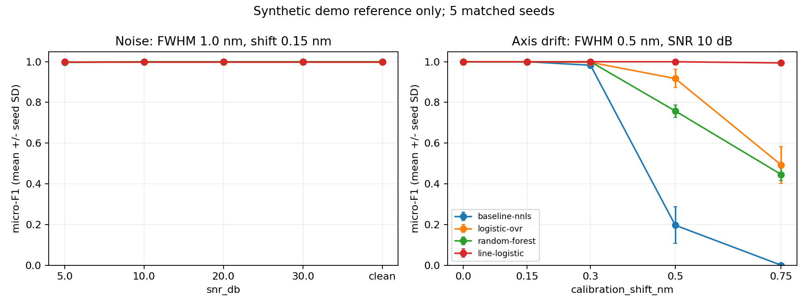

# Line-logistic: устойчивость к сдвигу спектральной оси

Реализована отдельная модель `line-logistic`, доступная в разделе «Анализ».
Она классифицирует присутствие H, He, Na, Mg, Ca, Fe по локальным признакам
вокруг справочных линий. Результаты ниже относятся к синтетическому
`demo_fixture`; реальные ChemCam-профили и их пороги не изменены.

## Изменение модели

Для каждого элемента из справочника выбираются до шести сильных линий заданной
ионной стадии с минимальным расстоянием 0.4 nm. Выбор выполняется по справочнику,
без интенсивностей обучающих или тестовых наблюдений. Текущий справочник даёт
29 позиций и **174 признака вместо 9001 пикселя** полного спектра:

- три полуширины окна: 0.2, 0.6, 1.2 nm;
- для каждого окна — 90-й перцентиль интенсивности и средняя интенсивность;
- локальный фон — медиана боковых пикселей на расстоянии 1.6–2.5 nm;
- преобразование `arcsinh(20 × corrected_feature)` и StandardScaler,
  обученный только на train;
- balanced logistic regression, C=1, отдельно по каждому элементу.

Предсказания — decision margins, **не вероятности**. При необходимости
поддерживается отдельная sigmoid calibration с раздельными группами
calibrate/tune. Одноклассовые обучающие столбцы имеют явный положительный или
отрицательный fallback. Геометрия окон, источник, scaler, seed, split IDs,
пороги и SHA-256 сохраняются в стандартном артефакте.

## Протокол сравнения

Сравниваются NNLS, полный logistic-ovr, Random Forest и line-logistic на пяти
seed: 7, 17, 29, 43, 71. У всех одинаковы данные и групповые разбиения:
144 базовых состава, по две вариации; train — 86 групп, validation — 29,
test — 29. Пороги выбираются только на validation.

Контролируемые спектры генерируются отдельно: 18 фиксированных single/mixture
составов на condition, повторённых для пяти seed обучения/шума. Их IDs не
пересекаются с train/validation/test dataset. Это controlled-degradation
проверка, а не эксперимент unseen-combinations или реальный независимый final.

Сначала выполнен шумовой benchmark: SNR 5/10/20/30 dB и clean, FWHM=1.0 nm,
shift=0.15 nm. NNLS, logistic-ovr и line-logistic дали F1=1.00 во всех conditions:
этот набор слишком прост, чтобы подтвердить превосходство новой модели.

Затем, без изменения признаков, C или порогов по этим результатам, выполнен
отдельный drift benchmark: shift=0/0.15/0.3/0.5/0.75 nm при SNR=10 dB,
FWHM=0.5 nm. Крупные сдвиги — стресс вне типичного training jitter 0.015 nm.

## Результаты drift benchmark

Средний micro-F1 по пяти matched seed:

| Сдвиг, nm | NNLS | Logistic-OVR | Random Forest | Line-logistic |
| --- | --- | --- | --- | --- |
| 0 | 1.000 | 1.000 | 1.000 | 1.000 |
| 0.15 | 1.000 | 1.000 | 1.000 | 1.000 |
| 0.30 | 0.983 | 0.997 | 1.000 | 1.000 |
| 0.50 | 0.196 | 0.917 | 0.758 | **1.000** |
| 0.75 | 0.000 | 0.493 | 0.446 | **0.994** |

На shift=0.75 nm exact-match для line-logistic — 0.978 против 0.144 у
logistic-ovr. При 0.50 и 0.75 nm прирост F1 положителен на каждом из пяти seed.
Полосы ошибок на графике — SD по seed, а не доверительные интервалы для
реальных материалов. Conditions используют одни и те же составы; их нельзя
считать независимыми новыми материалами.



[Численные результаты, hashes источников и парные различия по seed](line_classifier_v1_summary.json).

## Использование и воспроизведение

```bash
make line-model
make line-model-benchmark
make series CONFIG=ml/configs/experiments/line_classifier_drift.yaml
```

`make line-model` обучает только новый ID и сохраняет его в
`artifacts/models/line-logistic`. В запущенном приложении после загрузки нового
backend-кода обновите страницу и выберите «Метод распознавания → line-logistic».
Остальные модели остаются доступны для сравнения. Приборный measured inference
по Ca/ChemCam — отдельный workflow.

Для перерисовки отчёта без обучения:

```bash
scripts/uv.sh run --frozen --all-packages --no-sync python scripts/report_line_classifier.py \
  --noise-run reports/experiments/<noise-series-id> \
  --drift-run reports/experiments/<drift-series-id>
```

Протоколы: `ml/configs/experiments/line_classifier.yaml` и
`ml/configs/experiments/line_classifier_drift.yaml`. Полные runs, модели и split
hashes находятся в указанных в summary каталогах. Они являются локальными
производными; tracked JSON и график сохраняют компактный результат.

## Ограничения

Показана устойчивость к известному типу синтетического дрейфа на простом
справочнике. Не измерены выигрыш на реальных образцах, матричные эффекты,
неизвестные элементы и пределы обнаружения. Увеличенные окна могут смешивать
близкие линии в насыщенном реальном спектре. Feature extraction стоит
дополнительного времени; уменьшение числа признаков не означает ускорения
inference относительно полного logistic-ovr. Количественный состав и физическая
температура плазмы этой моделью не оцениваются.
