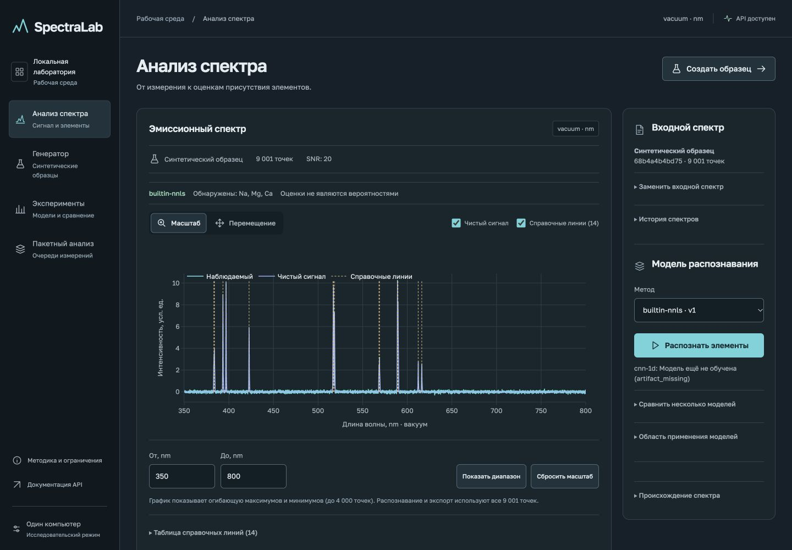

# Photon · обновление интерфейса

20 октября 2026 года. Пользователь выбрал Photon и полное обновление четырёх
разделов локального приложения: анализ, генератор, эксперименты и пакетный анализ.

Графитовые поверхности, бирюзовый сигнал, локальный Golos Text с кириллицей,
единые SVG-иконки и оформление Plotly заменяют прежнюю визуальную систему.
На компьютере доступны подписанная навигация и инспектор; на узком экране меню
сворачивается, формы и результаты идут последовательно.

## Изменения сценариев

- Анализ: компактный выбранный вход, явный запуск после выбора модели, краткое
  решение рядом со спектром, полная таблица score/порогов и единая группа
  пояснений. Загрузка, история, metadata и экспорты сохранены.
- Генератор: состав и запуск перед длинными настройками; сохранённый сигнал
  явно отделён от редактируемых параметров. Истинные метки остаются отдельно
  от распознавания, вклады не названы концентрациями.
- Эксперименты: вкладки отчётов и заданий, ограниченная по высоте история,
  сворачивание после выбора, короткие легенды. Агрегаты предшествуют раскрываемым
  данным о seed, конфигурации, источнике и хешах.
- Пакетный анализ: при пустой истории на телефоне подготовка стоит первой.
  Приём CSV отделён от выполнения «файл × модель»; используются реальные
  серверные состояния, версии моделей и происхождение результатов.

## Проверка

На окончательном коде прошли:

- `scripts/npm.sh --prefix frontend test`: **33/33**, шесть файлов.
- `scripts/npm.sh --prefix frontend run lint`: без замечаний.
- `scripts/npm.sh --prefix frontend run build`: TypeScript и production-сборка
  успешны. Предупреждение Vite о лениво загружаемом Plotly около 1 MB сохранено.
- `git diff --check`: без ошибок.

Все четыре раздела визуально проверены при 1440 и 390 px, дополнительно анализ
при 1280 px и пакетный раздел при 768 px. Горизонтального переполнения страницы
нет; широкие таблицы прокручиваются внутри своих областей. Это проверка
адаптивного viewport в desktop-браузере, не физического телефона или скринридера.

Вручную на настоящем локальном API проверены генерация Na/Mg/Ca на мобильной
ширине, переход в анализ и распознавание, смена диапазона и сброс, подсветка
справочной линии с сохранением масштаба, фильтр состава отчёта, выбор и
сворачивание каталога, вкладки заданий, отказ на повторяющихся seed и мобильное
меню. CSV экспортирован из генератора, выбран через системный file chooser,
проверен и загружен в отдельную очередь. Отдельный worker завершил **1/1**
результат без ошибок; интерфейс показал Na/Mg/Ca и сохранённую версию модели.

Playwright E2E в этой итерации не запускался; существующий сценарий каталога
обновлён на стабильные `data-run-id` вместо технического ID в заголовке.
Предыдущие E2E-проверки описаны в [frontend-validation.md](frontend-validation.md).

## Дизайн-ревью и система

Применены UI/UX Pro Max, Taste и Impeccable. Taste прочитан из официального
репозитория; локального установленного скилла Taste не было. Photon выбран
пользователем из предложенных направлений, seed `3a210325`, реализация code-led.

Независимый агент проверил 12 снимков. После одной общей партии исправлений
все семь замечаний получили `resolved`, итоговый вердикт — **`ship`** в объёме
проверенных исправлений. Специальный тип Finish Reviewer был недоступен;
его контракт выполнил отдельный обычный агент с чистым контекстом.
Механический детектор запускался один раз и вернул `[]`.

Реальные токены и компоненты записаны в [DESIGN.md](../DESIGN.md) и
`.impeccable/design.json`; направление — в
`.impeccable/surfaces/frontend-src-app-tsx.md`. Golos Text размещён локально
под SIL OFL 1.1, лицензия и источники находятся в `frontend/public/fonts/`.
Продуктовых растровых иллюстраций нет; снимок выше получен из собственного
интерфейса на явно синтетическом образце.

Данная итерация не меняет научную модель, её пороги или статус независимой
валидации. NEXT12 с измеренным heartbeat/backup/диском остаётся отдельной задачей;
доступность API не выдается за доступность worker.
